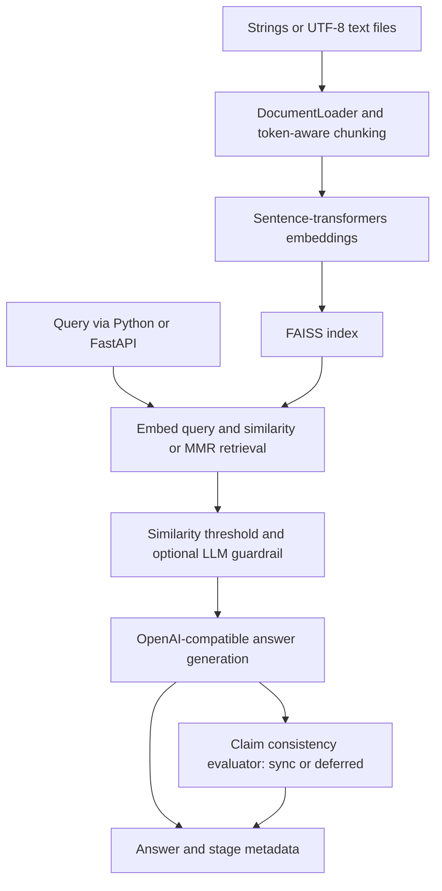

# EvalForge

**An ML Evaluation and Optimization Platform for Retrieval-Augmented Language Models**

An extensible machine learning evaluation platform for benchmarking retrieval-augmented generation pipelines, analyzing model reliability, and optimizing inference performance.

Version **0.1.0** · Maintainer: **Pratham Pathak** · [Repository](https://github.com/Prathampthk/evalforge-ml) · [MIT license](LICENSE)

## Overview and motivation

EvalForge starts from an existing Python RAG implementation and establishes a foundation for reproducible evaluation and future inference optimization. This initial release preserves that implementation, documents its behavior, and separates the available evaluation harnesses from the planned ML platform. It does not claim independent authorship of the inherited code or measured performance improvements.

## Current capabilities

Verified in source; external model execution depends on installed dependencies, downloaded embeddings, and provider credentials:

- UTF-8 text file and string loading; token-window, sentence/paragraph-aware token chunking, and legacy character splitting.
- Sentence-transformers embeddings with dimension checks; default `BAAI/bge-large-en-v1.5` (1024 dimensions).
- FAISS flat, IVF, and HNSW indexes, similarity search, MMR selection, and explicit save/load methods. IVF requires sufficient training vectors.
- Similarity threshold filtering; optional LLM relevance scoring and safety flags. The guardrail is disabled by default and is not a security guarantee.
- Context-grounded generation through an OpenAI-compatible client; claim-based consistency evaluation in synchronous or deferred mode.
- FastAPI text ingestion, query, health, and schema endpoints with bearer authentication, rate limiting, and host/CORS controls.
- OpenTelemetry spans, metrics, structured logs, and optional local observability services.
- Dataset-fixture checks, a live RAGAS runner with cached pipeline outputs, and report threshold gates.

## System architecture



Deferred evaluation returns a pending placeholder; there is no result-polling endpoint. Use synchronous evaluation when consuming reliability scores. Vector persistence is explicit; API startup does not automatically restore saved indexes. See [architecture](docs/ARCHITECTURE.md).

## Technology stack

Python, dataclasses, Pydantic, sentence-transformers, FAISS, tiktoken, OpenAI SDK, FastAPI/Uvicorn, RAGAS, pytest, OpenTelemetry, Docker, and GitHub Actions. Optional observability uses Jaeger, Prometheus, and Grafana. Dependencies have version ranges rather than a reproducible lockfile.

## Repository structure

```text
evalforge-ml/
├── main.py                  # RAGPipeline orchestration
├── config.py                # Configuration dataclasses
├── models.py                # Shared data contracts
├── document_loader.py       # Text loading
├── chunking.py              # Chunking strategies
├── embeddings.py            # Local embedding model
├── vector_store.py          # FAISS, MMR, persistence
├── retriever.py              # Query retrieval
├── llm_client.py             # LLM transport
├── guardrail_agent.py        # Optional relevance/safety stage
├── generator.py              # Answer generation
├── evaluator_agent.py        # Claim consistency stage
├── api.py / demo.py          # HTTP service / console demo
├── evaluation/              # Datasets, runners, quality gates
├── observability/           # Collector and dashboard configuration
├── tests/ / docs/           # Tests and technical documentation
└── .github/workflows/       # Existing CI and evaluation harness
```

Historical upstream audits and `.planning/` records are retained as provenance; they are not current release specifications.

## Installation

Use Python **3.11**, matching Docker and CI. The code targets Python 3.10+, but this release does not establish compatibility with every newer interpreter.

```bash
git clone https://github.com/Prathampthk/evalforge-ml.git
cd evalforge-ml
python3.11 -m venv .venv
source .venv/bin/activate
python -m pip install -r requirements.txt
cp .env.example .env
```

On Windows use `py -3.11 -m venv .venv`, `.venv\Scripts\Activate.ps1`, and `Copy-Item .env.example .env`. First use requires downloading the embedding model and possibly tokenizer assets. This repository runs from its root; it is not currently an installable Python distribution.

## Environment configuration

Edit `.env` with a valid provider API key and a unique bearer token:

```dotenv
OPENAI_API_KEY=replace-with-your-api-key
LLM_MODEL=gpt-4o-mini
RAG_API_TOKEN=replace-with-a-long-random-token
RAG_AUTH_DISABLED=false
TELEMETRY_SERVICE_NAME=evalforge
SERVICE_VERSION=0.1.0
```

Leave `LLM_BASE_URL` unset for OpenAI, or set an OpenAI-compatible provider endpoint and matching model. See [.env.example](.env.example) and [configuration](docs/CONFIGURATION.md).

Embedding, vector index, chunking, and runtime settings use Python dataclasses, not environment variables:

```python
from config import PipelineConfig, RuntimeConfig
from main import RAGPipeline

config = PipelineConfig(runtime=RuntimeConfig(use_guardrail=True, evaluator_mode="sync"))
with RAGPipeline(config) as pipeline:
    pipeline.ingest(["EvalForge evaluates retrieval-augmented generation pipelines."])
    result = pipeline.query("What does EvalForge evaluate?")
    print(result.answer, result.evaluation_status)
```

Existing `RAG_*` environment keys and `RAGPipeline` imports remain supported.

## Running the application

```bash
python demo.py
# Or start the HTTP service:
python -m uvicorn api:app --host 127.0.0.1 --port 8000
```

Local API docs: `http://127.0.0.1:8000/docs`; health: `http://127.0.0.1:8000/health`.

```bash
curl -X POST http://127.0.0.1:8000/ingest \
  -H "Authorization: Bearer $RAG_API_TOKEN" \
  -H 'Content-Type: application/json' \
  -d '{"texts":["EvalForge evaluates RAG pipelines."]}'
curl -X POST http://127.0.0.1:8000/query \
  -H "Authorization: Bearer $RAG_API_TOKEN" \
  -H 'Content-Type: application/json' \
  -d '{"query":"What does EvalForge evaluate?","sync_evaluation":true}'
```

Export `RAG_API_TOKEN` in your shell for these curl commands; `.env` loading inside Python does not export shell variables.

```bash
docker compose up --build
```

The image is `evalforge-ml:0.1.0`. Existing Compose service/network/container identifiers are preserved. The container entrypoint defaults to four workers, each with an independent in-memory index. For ingestion/query consistency in local use, run one worker via `docker compose run --rm --service-ports -e GUNICORN_WORKERS=1 rag-api`. A mounted volume alone does not synchronize indexes or automatically save/restore them. See [deployment notes](docs/DEPLOYMENT.md).

## Running evaluation benchmarks

Real pipeline plus RAGAS scoring (requires model downloads, provider credentials, judge tokens, and optional adapters):

```bash
python -m pip install -r requirements-ragas.txt
python -m evaluation.run_ragas --limit 3
# Cache pipeline outputs first, or resume scoring later:
python -m evaluation.run_ragas --pipeline-only --limit 3
python -m evaluation.run_ragas --resume
```

Default corpus: `evaluation/datasets/ragas_corpus.json`; questions: `evaluation/datasets/ragas_eval.jsonl`; output: `evaluation/reports/ragas-latest.json`. Cached answers must match the intended corpus, configuration, and question set before resuming. The [notebook](eval_ragas.ipynb) provides another entry point.

For deterministic harness checks without inference:

```bash
python -m evaluation.run_eval \
  --dataset evaluation/datasets/phase2_eval.jsonl \
  --output evaluation/reports/phase2-latest.json
python -m evaluation.quality_gates --report evaluation/reports/phase2-latest.json
```

These offline scores are fixed values selected by dataset annotations, **not measured model quality or RAGAS results**. `run_eval --live` uses heuristic metrics and does not ingest a corpus or load an index; it is not a meaningful end-to-end retrieval benchmark as shipped. The existing evaluation workflow defaults to fixture checks, and its live option lacks provider-secret wiring. Use `run_ragas` for corpus-backed evaluation.

## Evaluation metrics

| Metric | Existing implementation and interpretation |
|---|---|
| Faithfulness | RAGAS judge metric in `run_ragas`; separate claim-consistency score in the pipeline |
| Answer relevancy | RAGAS embedding/judge metric; `run_eval --live` uses an answer substring heuristic |
| Context precision / recall | RAGAS metrics in `run_ragas`; live heuristic runner uses expected/retrieved chunk-ID overlap |
| Latency | Pipeline stage timers and RAGAS report latency summaries; no published benchmark results |
| Quality gates | Faithfulness ≥ 0.90 and answer relevancy ≥ 0.95; context metrics informational |

Passing thresholds on fixture reports validates the harness only. It does not establish model reliability. No measured release benchmark is published here.

## Testing

```bash
python -m pip install -r requirements-dev.txt
python -m pytest tests/
python -m black --check .
python -m flake8 .
python -m mypy
```

On the macOS Python 3.14 validation host, the suite required `OMP_NUM_THREADS=1` to avoid a native FAISS crash (60 passed, 24 credential-dependent tests skipped). Python 3.11 and Docker validation remain outstanding.

Tests exercise loading, embeddings, vector indexes, retrieval, agents, runtime behavior, telemetry, evaluation, and API behavior. Many substitute fake models/clients. Existing CI excludes `tests/test_api.py` from its unit-test job; run the full suite locally. See [testing](docs/TESTING.md) and the [release audit](docs/RELEASE_AUDIT.md) for actual validation results and limitations.

## Development roadmap

All items below are planned; existing components provide a foundation rather than completion of these milestones.

### v0.2 — Retrieval Benchmarking

- BM25 retrieval, dense retrieval baselines, and hybrid retrieval.
- Recall@K and MRR evaluation; reproducible retrieval experiments.

### v0.3 — Model Evaluation

- Multi-model inference comparisons and expanded answer faithfulness evaluation.
- Hallucination analysis, latency and token-cost benchmarking, and experiment tracking.

### v0.4 — ML Optimization

- Feature extraction for inference configurations and ML-based configuration selection.
- Model training and validation; comparison against rule-based baselines.
- Quality-cost optimization.

### v1.0 — Production Readiness

- Experiment dashboard and expanded CI/CD.
- Automated regression testing against measured results.
- Monitoring and observability hardening; validated deployment documentation.

## Project status

**v0.1.0: initial EvalForge identity and documented RAG foundation.** Existing CI, evaluation, and observability code is retained. Production readiness, cross-model optimization, and comprehensive benchmark reproducibility remain future work. See [release notes](CHANGELOG.md) and [release audit](docs/RELEASE_AUDIT.md) before publishing.

## License and acknowledgements

MIT licensed; see [LICENSE](LICENSE). The original notice, **Copyright (c) 2026 Satyam Shivam**, is retained. EvalForge builds on [satyamshivam13/RAG_Pipeline](https://github.com/satyamshivam13/RAG_Pipeline); rebranding does not imply independent authorship of the inherited implementation. See [NOTICE](NOTICE) for provenance. Third-party libraries and model weights retain their own licenses and terms.

Maintainer: Pratham Pathak ([Prathampthk](https://github.com/Prathampthk), prathampthk13@gmail.com).
