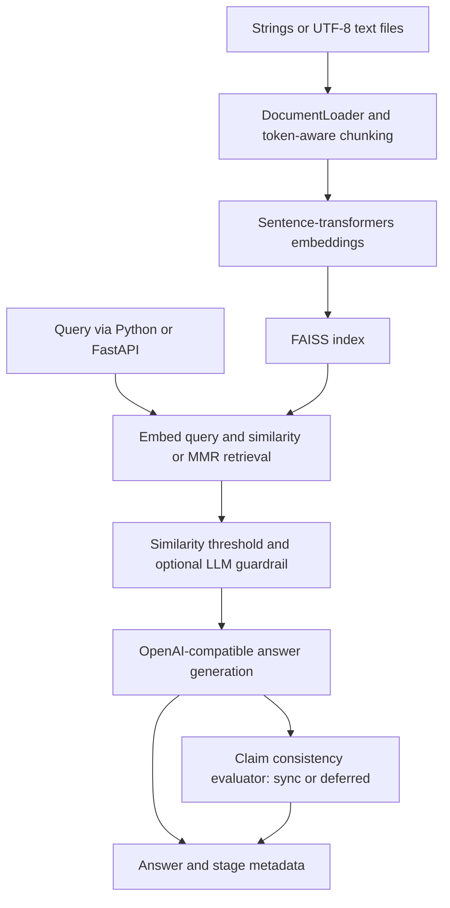

# EvalForge

**Reproducible Retrieval Evaluation and Index Benchmarking**

An extensible machine learning evaluation platform for benchmarking retrieval-augmented generation pipelines, analyzing model reliability, and optimizing inference performance.

Version **0.1.0 foundation + unreleased retrieval infrastructure upgrade** · Maintainer: **Pratham Pathak** · [Repository](https://github.com/Prathampthk/evalforge-ml) · [MIT license](LICENSE)

## Retrieval serving and performance engineering

EvalForge now includes an LLM-free FastAPI retrieval service, concurrent HTTP load tests, and atomic versioned FAISS snapshots shared safely across workers. [Measured HTTP results](docs/SERVING_PERFORMANCE.md): **36,000 real MiniLM retrieval requests, zero errors**, with full embedding/search/HTTP stage distributions. On one CPU host, two workers at 16 concurrent clients delivered **362.8 successful requests/s**, P50/P95/P99 **51.61/81.08/121.15 ms**. This is a short loopback load test, not a production capacity claim; the old sub-millisecond lookup results remain separately labeled.

[Cross-domain experiments](docs/CROSS_DOMAIN_RESULTS.md) compare TF-IDF, dense exact, HNSW and IVF with explicit dataset versions/exclusions. [Snapshot consistency](docs/SNAPSHOT_CONSISTENCY.md) covers concurrent ingestion, pinned readers, checksums, CAS conflicts and restart/crash recovery. See the [audit](docs/PERFORMANCE_AUDIT.md) for validation and limitations.

```bash
python -m pip install -r requirements-experiments.txt -r requirements-serving.txt
python -m evaluation.prepare_dataset --dataset scifact --output data/scifact
python -m evaluation.prepare_model
OMP_NUM_THREADS=1 python -m serving.build_snapshot --manifest data/scifact/test.manifest.json --output artifacts/serving-new
# Set a unique bearer token before exposing the service:
export EVALFORGE_SNAPSHOT_DIR=artifacts/serving-new
python -m uvicorn serving.api:app --workers 2 --host 127.0.0.1 --port 8000
```

The new app exposes authenticated `POST /retrieve` (`query`, `k`) and `POST /documents` (`documents: [{id,text}]`, optional `expected_version`). Every retrieval reports its snapshot version and stage timings. The legacy `api:app` remains available. On macOS, read the [native runtime setup](docs/SERVING_PERFORMANCE.md#reproduce) before building/loading real embeddings.

## Overview and motivation

EvalForge extends an existing Python RAG implementation with versioned relevance datasets, tested ranking metrics, controlled lexical/dense experiments, index scaling measurements, and paired statistical comparisons. Its focus is retrieval relevance and quality/performance tradeoffs; asynchronous LLM job scheduling belongs to AgentEval. The inherited RAG serving and answer-evaluation paths remain available, with upstream attribution retained.

## Retrieval evaluation quick start

```bash
python -m pip install -r requirements-experiments.txt
# Small deterministic CI fixture, no downloads or credentials:
OMP_NUM_THREADS=1 python -m evaluation.experiment \
  --config configs/experiments/regression.json --output evaluation/reports/regression-new
python -m evaluation.retrieval_gate \
  --report evaluation/reports/regression-new/report.json \
  --baseline evaluation/baselines/regression-v1.json

# Public SciFact benchmark: explicit small dataset and pinned CPU model downloads:
python -m evaluation.prepare_dataset --output data/scifact
python -m evaluation.prepare_model
OMP_NUM_THREADS=1 python -m evaluation.experiment \
  --config configs/experiments/scifact.json --output evaluation/reports/scifact-new
python -m evaluation.compare \
  --report evaluation/reports/scifact-new/report.json \
  --output evaluation/reports/scifact-new/comparison.md
```

Use a new empty output directory for each run. Commands run from the repository root after creating a Python environment. Dense experiments fail if the pinned model is unavailable; they do not substitute synthetic embeddings. See [dataset provenance/licenses](docs/DATASETS.md), [metric and experiment methodology](docs/EXPERIMENTS.md), and [resume evidence](RESUME_EVIDENCE.md).

The upgrade preserves the original 22-query/20-passage fixture and supports BEIR SciFact with **5,183 documents, 300 test queries and 339 judgments**. Compare TF-IDF, pinned MiniLM dense exact search, MMR, HNSW and IVF across three real corpus sizes. Reports include five ranking metrics, per-query results, paired bootstrap intervals, build/encoding timings, P50/P95/P99 index-query latency, serial QPS, memory estimates, and ANN agreement with exact search. [Measured comparisons](docs/SCIFACT_RESULTS.md) document scope and limitations; no end-to-end RAG throughput or judge-accuracy claim is implied.

## Current capabilities

Verified in source; external model execution depends on installed dependencies, downloaded embeddings, and provider credentials:

- UTF-8 text file and string loading; token-window, sentence/paragraph-aware token chunking, and legacy character splitting.
- Sentence-transformers embeddings with dimension checks; default `BAAI/bge-large-en-v1.5` (1024 dimensions).
- FAISS flat, IVF, and HNSW indexes, similarity search, MMR selection, and explicit save/load methods. IVF requires sufficient training vectors.
- Similarity threshold filtering; optional LLM relevance scoring and safety flags. The guardrail is disabled by default and is not a security guarantee.
- Context-grounded generation through an OpenAI-compatible client; claim-based consistency evaluation in synchronous or deferred mode.
- FastAPI text ingestion, query, health, and schema endpoints with bearer authentication, rate limiting, and host/CORS controls.
- OpenTelemetry spans, metrics, structured logs, and optional local observability services.
- Dataset-fixture checks, a live RAGAS runner with cached pipeline outputs, and report threshold gates.

## System architecture



Deferred evaluation returns a pending placeholder; there is no result-polling endpoint. Use synchronous evaluation when consuming reliability scores. Vector persistence is explicit; API startup does not automatically restore saved indexes. See [architecture](docs/ARCHITECTURE.md).

## Technology stack

Python, scikit-learn, SciPy, psutil, PyYAML, dataclasses, Pydantic, sentence-transformers, FAISS, tiktoken, OpenAI SDK, FastAPI/Uvicorn, RAGAS, pytest, OpenTelemetry, Docker, and GitHub Actions. Optional observability uses Jaeger, Prometheus, and Grafana. Runtime requirements use version ranges; a snapshot of the measured environment is retained with the benchmark evidence.

## Repository structure

```text
evalforge-ml/
├── main.py                  # RAGPipeline orchestration
├── config.py                # Configuration dataclasses
├── models.py                # Shared data contracts
├── document_loader.py       # Text loading
├── chunking.py              # Chunking strategies
├── embeddings.py            # Local embedding model
├── vector_store.py          # FAISS, MMR, persistence
├── retriever.py              # Query retrieval
├── llm_client.py             # LLM transport
├── guardrail_agent.py        # Optional relevance/safety stage
├── generator.py              # Answer generation
├── evaluator_agent.py        # Claim consistency stage
├── api.py / demo.py          # HTTP service / console demo
├── evaluation/              # Versioned datasets, ranking, experiments, RAGAS and gates
├── configs/experiments/     # Regression and public benchmark configurations
├── observability/           # Collector and dashboard configuration
├── tests/ / docs/           # Tests and technical documentation
└── .github/workflows/       # Existing CI and evaluation harness
```

Historical upstream audits and `.planning/` records are retained as provenance; they are not current release specifications.

## Installation

Use Python **3.11**, matching Docker and CI. The code targets Python 3.10+, but this release does not establish compatibility with every newer interpreter.

```bash
git clone https://github.com/Prathampthk/evalforge-ml.git
cd evalforge-ml
python3.11 -m venv .venv
source .venv/bin/activate
python -m pip install -r requirements.txt
cp .env.example .env
```

On Windows use `py -3.11 -m venv .venv`, `.venv\Scripts\Activate.ps1`, and `Copy-Item .env.example .env`. First use requires downloading the embedding model and possibly tokenizer assets. This repository runs from its root; it is not currently an installable Python distribution.

## Environment configuration

Edit `.env` with a valid provider API key and a unique bearer token:

```dotenv
OPENAI_API_KEY=replace-with-your-api-key
LLM_MODEL=gpt-4o-mini
RAG_API_TOKEN=replace-with-a-long-random-token
RAG_AUTH_DISABLED=false
TELEMETRY_SERVICE_NAME=evalforge
SERVICE_VERSION=0.1.0
```

Leave `LLM_BASE_URL` unset for OpenAI, or set an OpenAI-compatible provider endpoint and matching model. See [.env.example](.env.example) and [configuration](docs/CONFIGURATION.md).

Embedding, vector index, chunking, and runtime settings use Python dataclasses, not environment variables:

```python
from config import PipelineConfig, RuntimeConfig
from main import RAGPipeline

config = PipelineConfig(runtime=RuntimeConfig(use_guardrail=True, evaluator_mode="sync"))
with RAGPipeline(config) as pipeline:
    pipeline.ingest(["EvalForge evaluates retrieval-augmented generation pipelines."])
    result = pipeline.query("What does EvalForge evaluate?")
    print(result.answer, result.evaluation_status)
```

Existing `RAG_*` environment keys and `RAGPipeline` imports remain supported.

## Running the application

```bash
python demo.py
# Or start the HTTP service:
python -m uvicorn api:app --host 127.0.0.1 --port 8000
```

Local API docs: `http://127.0.0.1:8000/docs`; health: `http://127.0.0.1:8000/health`.

```bash
curl -X POST http://127.0.0.1:8000/ingest \
  -H "Authorization: Bearer $RAG_API_TOKEN" \
  -H 'Content-Type: application/json' \
  -d '{"texts":["EvalForge evaluates RAG pipelines."]}'
curl -X POST http://127.0.0.1:8000/query \
  -H "Authorization: Bearer $RAG_API_TOKEN" \
  -H 'Content-Type: application/json' \
  -d '{"query":"What does EvalForge evaluate?","sync_evaluation":true}'
```

Export `RAG_API_TOKEN` in your shell for these curl commands; `.env` loading inside Python does not export shell variables.

```bash
docker compose up --build
```

The image is `evalforge-ml:0.1.0`. Existing Compose service/network/container identifiers are preserved. The legacy container entrypoint now defaults to one worker. Multiple legacy workers require explicit pinned shared-snapshot mode; a mounted volume alone does not synchronize the legacy index. The separate `Dockerfile.retrieval` runs the new snapshot-aware retrieval app with two workers. See [deployment notes](docs/DEPLOYMENT.md).

## Running evaluation benchmarks

Real pipeline plus RAGAS scoring (requires model downloads, provider credentials, judge tokens, and optional adapters):

```bash
python -m pip install -r requirements-ragas.txt
python -m evaluation.run_ragas --limit 3
# Cache pipeline outputs first, or resume scoring later:
python -m evaluation.run_ragas --pipeline-only --limit 3
python -m evaluation.run_ragas --resume
```

Default corpus: `evaluation/datasets/ragas_corpus.json`; questions: `evaluation/datasets/ragas_eval.jsonl`; output: `evaluation/reports/ragas-latest.json`. Cached answers must match the intended corpus, configuration, and question set before resuming. The [notebook](eval_ragas.ipynb) provides another entry point.

For deterministic harness checks without inference:

```bash
python -m evaluation.run_eval \
  --dataset evaluation/datasets/phase2_eval.jsonl \
  --output evaluation/reports/phase2-latest.json
python -m evaluation.quality_gates --report evaluation/reports/phase2-latest.json
```

These offline scores are fixed values selected by dataset annotations, **not measured model quality or RAGAS results**. `run_eval --live` uses heuristic metrics and does not ingest a corpus or load an index; it is not a meaningful end-to-end retrieval benchmark as shipped. The existing evaluation workflow defaults to fixture checks, and its live option lacks provider-secret wiring. Use `run_ragas` for corpus-backed evaluation.

### Local retrieval benchmark

```bash
OMP_NUM_THREADS=1 python -m evaluation.retrieval_benchmark
```

This new corpus-backed TF-IDF baseline compares existing FAISS similarity search and MMR across K=1, 3, 5. It reports Recall@K, MRR@K, NDCG@K, per-query rankings, and warm-query latency with dataset hashes and environment metadata. On the 22-question/20-passage repository sample, similarity search measured 95.45% Recall@5 and 0.9545 MRR@5. These are lexical fixture measurements, not LLM quality or production performance; the separate SciFact experiments now include dense retrieval. See [methodology and raw results](docs/BENCHMARKS.md).

## Evaluation metrics

| Metric | Existing implementation and interpretation |
|---|---|
| Faithfulness | RAGAS judge metric in `run_ragas`; separate claim-consistency score in the pipeline |
| Answer relevancy | RAGAS embedding/judge metric; `run_eval --live` uses an answer substring heuristic |
| Context precision / recall | RAGAS metrics in `run_ragas`; live heuristic runner uses expected/retrieved chunk-ID overlap |
| Latency | Pipeline stage timers and RAGAS summaries; retrieval timings reported separately, no published full-RAG results |
| Quality gates | Faithfulness ≥ 0.90 and answer relevancy ≥ 0.95; context metrics informational |

Passing thresholds on fixture reports validates the harness only. It does not establish model reliability. A local lexical retrieval baseline is documented separately; no measured release LLM benchmark is published here.

## Testing

```bash
python -m pip install -r requirements-dev.txt
OMP_NUM_THREADS=1 python -m pytest tests/
python -m black --check .
python -m flake8 .
python -m mypy
```

The pre-upgrade baseline was 72 passed / 24 skipped. The upgrade isolates API startup with mocks so those contract tests run without credentials; explicit in-memory exporters validate telemetry. The current local suite passes 169 tests with no skips. For real-model macOS runs, also follow the native-runtime setup in [serving methodology](docs/SERVING_PERFORMANCE.md). See the [performance audit](docs/PERFORMANCE_AUDIT.md) for current CI and Docker evidence.

Tests exercise loading, embeddings, vector indexes, retrieval, agents, runtime behavior, telemetry, evaluation, and API behavior. Many substitute fake models/clients. CI now includes the API contract tests and a versioned deterministic retrieval regression gate. The larger SciFact workflow runs separately, manually or monthly. See [testing](docs/TESTING.md) and the [release audit](docs/RELEASE_AUDIT.md) for actual validation results and limitations.

## Development roadmap

The retrieval infrastructure upgrade implements versioned data, lexical/dense/ANN comparisons, five ranking metrics and paired bootstrap analysis. Remaining milestones below extend that foundation; implemented components are not represented as future work.

### v0.2 — Retrieval Benchmarking

- Add BM25 and hybrid lexical/dense retrieval.
- Extend the implemented dense baselines, Recall/MRR/NDCG experiments, and index scaling to more held-out domains and seeds.

### v0.3 — Model Evaluation

- Multi-model inference comparisons and expanded answer faithfulness evaluation.
- Hallucination analysis, latency and token-cost benchmarking, and experiment tracking.

### v0.4 — ML Optimization

- Feature extraction for inference configurations and ML-based configuration selection.
- Model training and validation; comparison against rule-based baselines.
- Quality-cost optimization.

### v1.0 — Production Readiness

- Experiment dashboard and expanded CI/CD.
- Automated regression testing against measured results.
- Monitoring and observability hardening; validated deployment documentation.

## Project status

**v0.1.0 foundation with an unreleased retrieval-infrastructure upgrade.** Configuration-driven, provenance-rich retrieval experiments and small-fixture regression gates are implemented. Production readiness, cross-model inference optimization, multi-seed generalization, and independently validated LLM judgments remain future work. Measured domain comparisons and HTTP load tests are documented above. See [release notes](CHANGELOG.md) and [release audit](docs/RELEASE_AUDIT.md) before publishing.

## License and acknowledgements

MIT licensed; see [LICENSE](LICENSE). The original notice, **Copyright (c) 2026 Satyam Shivam**, is retained. EvalForge builds on [satyamshivam13/RAG_Pipeline](https://github.com/satyamshivam13/RAG_Pipeline); rebranding does not imply independent authorship of the inherited implementation. See [NOTICE](NOTICE) for provenance. Third-party libraries and model weights retain their own licenses and terms.

Maintainer: Pratham Pathak ([Prathampthk](https://github.com/Prathampthk), prathampthk13@gmail.com).
